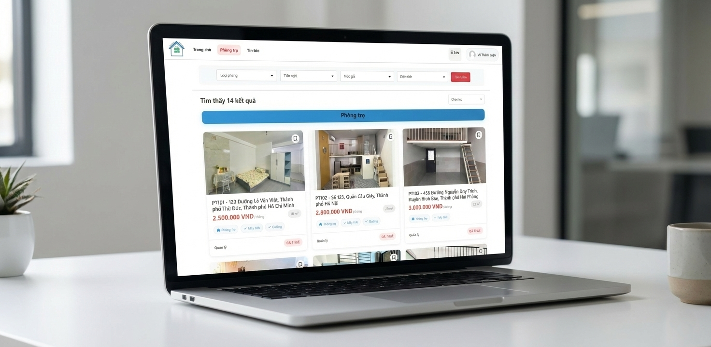

# Portfolio Assets Repository

Repository chứa tất cả tài nguyên (assets) cho website portfolio cá nhân.

## 📁 Cấu trúc thư mục

```
portfolio-assets/
└── images/          # Thư mục chứa hình ảnh và media files
    ├── Screenshots  # Ảnh chụp màn hình dự án
    ├── Certificates # Chứng chỉ và bằng cấp
    └── Media files  # Video, PDF và các file đa phương tiện khác
```

## 📊 Thống kê

- **Tổng số files**: 68 files
- **Định dạng hình ảnh**: 
  - PNG: 56 files
  - JPG: 9 files
  - MP4: 1 file (audio/video)
  - PDF: 1 file

## 🎯 Mục đích sử dụng

Repository này được tạo ra để:
- Lưu trữ tập trung tất cả assets cho website portfolio
- Dễ dàng quản lý và cập nhật hình ảnh dự án
- Tối ưu hóa việc load assets từ một nguồn duy nhất
- Tách biệt assets khỏi source code chính của website

## 📝 Nội dung chính

### Screenshots dự án
- Ảnh chụp màn hình các dự án đã thực hiện
- Screenshots từ các năm 2024-2025
- Demo các tính năng và giao diện

### Certificates & Documents
- Chứng chỉ: `7597 luan file DK thi toeic.jpg`
- Bảng điểm: `bangdiem.pdf`
- Các chứng chỉ kỹ thuật liên quan

### Media Files
- Avatar và hình đại diện: `avatar_webphong.png`
- Video demo: `audio.mp4`
- Các hình ảnh minh họa khác

## 🔗 Sử dụng

Assets trong repository này được sử dụng trên website portfolio thông qua các URL tĩnh hoặc CDN.

### Ví dụ sử dụng:
```html

```

## 📌 Lưu ý

- Đảm bảo tối ưu kích thước hình ảnh trước khi upload
- Đặt tên file có ý nghĩa và dễ quản lý
- Backup định kỳ repository này
- Không upload file quá lớn (khuyến nghị < 5MB/file)

## 🚀 Cập nhật

Repository được cập nhật thường xuyên khi có:
- Dự án mới hoàn thành
- Chứng chỉ mới đạt được
- Cập nhật hình ảnh profile

---

**Last Updated**: November 2026
